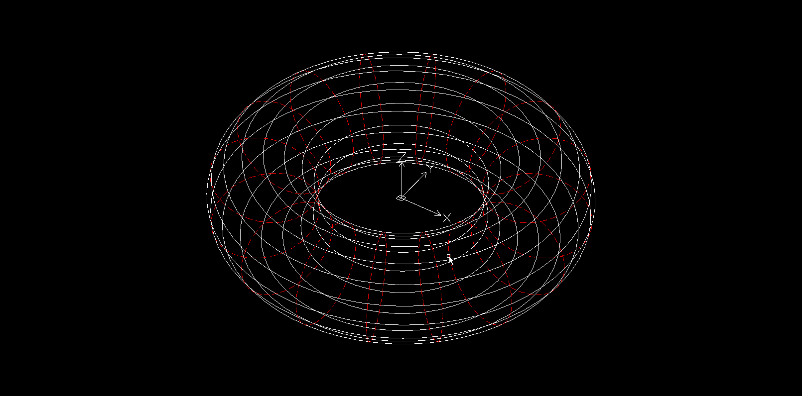

#dxf

DXF(Drawing Exchange Format by Autodesk, Inc) library for golang.

+ version: ACAD2000(AC1015)
+ format : ASCII

is only supported.

## Reference

[http://www.autodesk.com/techpubs/autocad/acad2000/dxf/index.htm](http://www.autodesk.com/techpubs/autocad/acad2000/dxf/index.htm)

## Example
```go
package main

import (
	"github.com/yofu/dxf"
	"github.com/yofu/dxf/color"
	"github.com/yofu/dxf/table"
	"log"
	"math"
)

func main() {
	d := dxf.NewDrawing()
	d.Header().LtScale = 100.0
	d.AddLayer("Toroidal", dxf.DefaultColor, dxf.DefaultLineType, true)
	d.AddLayer("Poloidal", color.Red, table.LT_HIDDEN, true)
	z := 0.0
	r1 := 200.0
	r2 := 500.0
	ndiv := 16
	dtheta := 2.0 * math.Pi / float64(ndiv)
	theta := 0.0
	for i := 0; i < ndiv; i++ {
		d.ChangeLayer("Toroidal")
		d.Circle(0.0, 0.0, z+r1*math.Cos(theta), r2-r1*math.Sin(theta))
		d.ChangeLayer("Poloidal")
		c, _ := d.Circle(r2*math.Cos(theta), r2*math.Sin(theta), 0.0, r1)
		dxf.SetExtrusion(c, []float64{-1.0 * math.Sin(theta), math.Cos(theta), 0.0})
		theta += dtheta
	}
	err := d.SaveAs("torus.dxf")
	if err != nil {
		log.Fatal(err)
	}
}
```



### Blocks

```go
d := dxf.NewDrawing()
d.BeginBlock("BOLT", 0.0, 0.0, 0.0) // entities below are added to the block
d.Circle(0.0, 0.0, 0.0, 5.0)
d.Line(-5.0, 0.0, 0.0, 5.0, 0.0, 0.0)
d.EndBlock()

ins, _ := d.Insert("BOLT", 100.0, 50.0, 0.0) // INSERT (block reference)
ins.Scale = []float64{2.0, 2.0, 1.0}
ins.Rotation = 45.0
```

Attributes: define them in the block; `Insert` creates the attributes with
default values.

```go
d.BeginBlock("TITLE", 0.0, 0.0, 0.0)
d.AttributeDefinition("NAME", "Drawing name", "untitled", 10.0, 5.0, 0.0, 3.0) // tag, prompt, default
d.EndBlock()

ins, _ := d.Insert("TITLE", 1000.0, 500.0, 0.0)
ins.SetAttribute("NAME", "Floor plan")
ins.Rotation = 90.0
d.SyncAttributes(ins) // after changing the insertion point, scale or rotation
```

### Entity properties

Color, linetype and lineweight are BYLAYER by default.

```go
l, _ := d.Line(0.0, 0.0, 0.0, 100.0, 0.0, 0.0)
l.SetColor(color.Red)       // 62 (SetColorByBlock / SetColorByLayer)
lt, _ := d.LineType("HIDDEN")
l.SetLineType(lt)           // 6 (nil: BYLAYER)
l.SetLineWeight(35)         // 370: 0.35 mm (table.LineWeightByBlock, ...)
```

### Ellipse and hatch

```go
// center, endpoint of the major axis (relative to the center), minor/major ratio
e, _ := d.Ellipse([]float64{0.0, 0.0, 0.0}, []float64{10.0, 0.0, 0.0}, 0.5)
e.Start, e.End = 0.0, math.Pi // elliptical arc (parameters in radians)

h, _ := d.Hatch([]float64{0.0, 0.0}, []float64{100.0, 0.0}, []float64{100.0, 50.0}) // solid fill
h.SetPattern("ANSI31", 0.0, 1.0)                   // or SetUserPattern(angle, spacing, double)
h.AddPolylinePath([][]float64{{10, 10}, {20, 10}, {20, 20}}, nil) // inner boundary (hole)
```

### Dimensions

The graphics of a dimension are generated in an anonymous block (`*Dn`)
using the dimension style (`d.DimStyle("Standard")`: arrow size, text height, ...).

```go
d.LinearDimension([]float64{0, 0, 0}, []float64{100, 0, 0}, []float64{50, 20, 0}, 0.0) // 0: horizontal, 90: vertical
d.AlignedDimension(p1, p2, location)
d.RadiusDimension(center, pointOnArc)
d.DiameterDimension(center, pointOnCircle)
d.AngularDimension(vertex, p1, p2, location)

dim.Text = "<> mm"            // "<>" is replaced by the measurement
d.RegenerateDimension(dim)    // after changing a dimension
```

### Leaders

```go
d.Leader([]float64{0, 0, 0}, []float64{10, 10, 0}) // arrowhead at the first point
// with an MTEXT annotation after a horizontal hookline (height 0: DIMTXT)
d.LeaderText("Note", 0.0, []float64{0, 0, 0}, []float64{10, 10, 0})
```

### Paper space and viewports

```go
d.PaperSpace() // following entities are created in paper space (Layout1)
d.LwPolyline(true, []float64{10, 10}, []float64{410, 10}, []float64{410, 287}, []float64{10, 287})
// a viewport at (210, 148.5) of 380 x 250 on paper, showing model space
// around (5000, 2500) with 6000 units in its height
d.Viewport([]float64{210, 148.5, 0}, 380, 250, []float64{5000, 2500}, 6000)
d.ModelSpace()

// other layouts (their entities are in the blocks *Paper_Space0, ...)
d.RenameLayout("Layout1", "Plan")
d.AddLayout("Section")
d.UseLayout("Section") // following entities are created in "Section"
d.Viewport([]float64{210, 148.5, 0}, 380, 250, []float64{0, 0}, 3000)
d.UseLayout("Model")
```

### Multiline text (MTEXT)

```go
d := dxf.NewDrawing()
// "\n" is converted to the paragraph break \P; width 0 means no wrapping.
mt, _ := d.MText("first line\nsecond line", 0.0, 0.0, 0.0, 2.5, 0.0)
mt.Attachment = entity.MTEXT_MIDDLE_CENTER
mt.Rotation = 30.0 // degrees

fmt.Println(mt.PlainText()) // text without MTEXT formatting codes
```

### Text encoding (non-ASCII text)

Up to AC1018, text in DXF files is stored in the code page of `$DWGCODEPAGE`.

```go
d := dxf.NewDrawing()
// default "ANSI_1252": non-ASCII characters are written as \U+XXXX escapes,
// which AutoCAD reads in any locale.
d.Text("日本語", 0.0, 0.0, 0.0, 10.0)

// write text in Shift_JIS (e.g. for applications that do not read \U+XXXX)
d.Header().CodePage = codepage.Japanese // "ANSI_932"
```

When reading, text is decoded according to `$DWGCODEPAGE` (or as UTF-8 for
AC1021 and later), and `\U+XXXX` / `\M+nXXXX` escapes are converted.
For files without `$DWGCODEPAGE`, the code page can be given:

```go
d, err := dxf.FromFileWithCodePage("sjis.dxf", codepage.Japanese)
```

### Editing

```go
walls := d.EntitiesOnLayer("WALL")                 // or d.Query(func(e entity.Entity) bool { ... })
d.Move(100, 0, 0, walls...)                        // also Rotate(base, angle, ...), Scale(base, factor, ...)
d.RemoveEntity(walls[0])
copies, _ := dxf.CopyEntities(d, entity.Rotate([]float64{0, 0, 0}, 90), walls...)
exploded, _ := dxf.Explode(d, insert)              // block reference -> entities
d.RenameLayer("WALL", "A-WALL")                    // also RemoveLayer, RenameBlock, RemoveBlock
```

Transformations are moves, rotations about the Z axis and uniform scaling
(`entity.Transform`); entities with an extrusion direction other than the
Z axis cannot be transformed.

### Binary DXF

```go
d.SaveAsBinary("drawing.dxf") // or d.SetFormatter(format.NewBinary()) and d.WriteTo(w)
d, err := dxf.FromFile("drawing.dxf") // binary DXF is detected by its sentinel
```

Values are written in the type of their group code (strings, doubles,
16/32/64-bit integers, booleans and binary chunks); text is converted to
the code page of `$DWGCODEPAGE` as in ASCII DXF. Binary DXF of R12
(1-byte group codes) can also be read.

### Reading and writing back

When a file is read and written again, data this package does not
interpret is kept: unknown header variables (`Header().Extra`), entities of
unsupported types (`entity.Unknown`), extended data (`XData()` /
`SetXData()`, APPIDs are registered when writing) and other values of
LAYER, VIEW, UCS, DIMSTYLE and BLOCK_RECORD entries (`Extra`).
Groups (`Groups`) and layouts (`Layouts()`) are read from the OBJECTS section.

Not kept: handles (renumbered when writing) and references by handle,
unsupported entities referring to other objects (e.g. IMAGE), the other
objects of the OBJECTS section and the CLASSES section.

## Installation

```
$ go get github.com/yofu/dxf
```

# License

MIT

# Author

Yoshihiro FUKUSHIMA
